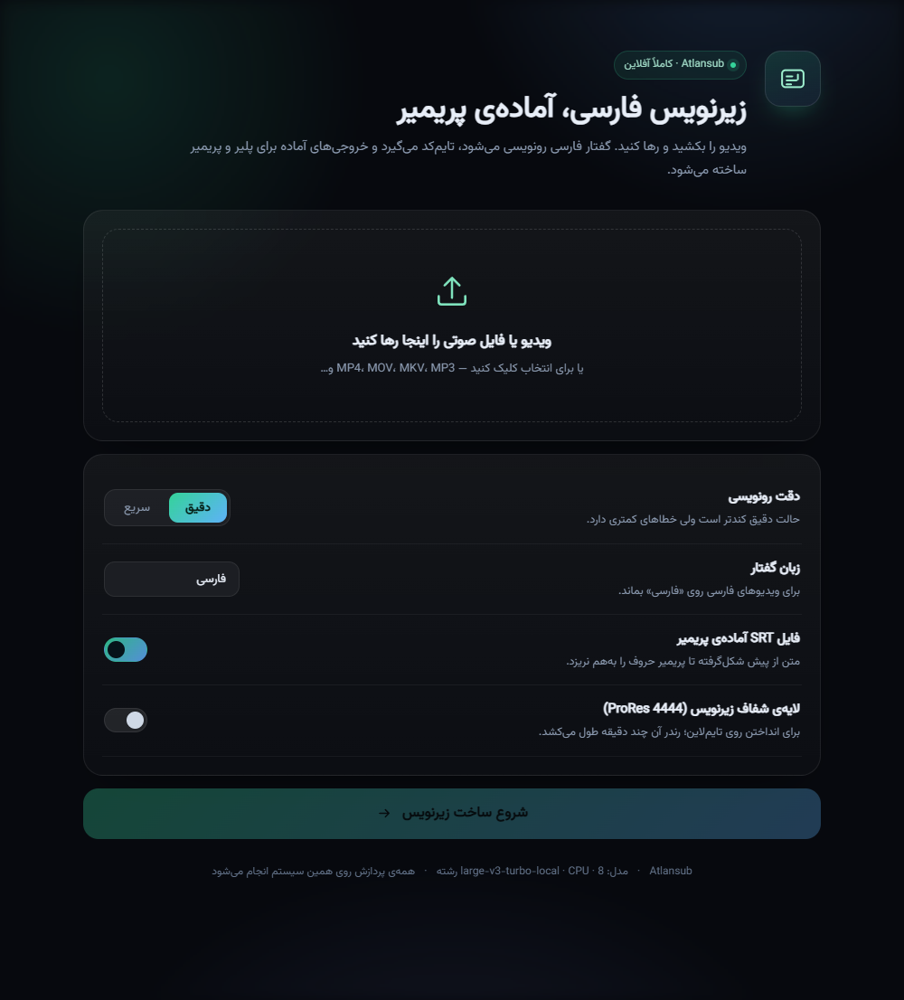

# Atlansub

**Offline Persian (Farsi) subtitle generator with a local web UI — built for Adobe Premiere.**

Drop a video, get transcribed Persian subtitles with timings, a Premiere-safe SRT, and an optional transparent ProRes 4444 overlay with alpha.

[خواندن راهنما به فارسی](README-fa.md)



---

## Why Atlansub?

Persian subtitles are painful in Adobe Premiere: the Premiere caption engine does not apply Arabic/Persian shaping and bidi, so letters get disconnected and reordered. Atlansub handles this in two ways:

* **`*.fa.premiere.srt`** — the text is already shaped (Arabic reshaper) and stored in visual order, so Premiere displays it correctly.
* **`*.fa.overlay.mov`** — a transparent ProRes 4444 video with the subtitles rendered by libass (proper shaping, RTL, Vazirmatn font, real alpha). Drop it on the timeline above your footage and you are done.

And everything runs locally. No cloud, no API keys, no uploads.

## Features

- **Drag & drop** any common video or audio format (MP4, MOV, MKV, MP3, WAV, …)
- **Persian-first UI**, fully RTL, offline
- **Word-level timestamps** from faster-whisper, regrouped into readable cues (~42 characters / ~6 s)
- **Three subtitle outputs**: plain logical SRT, Premiere pre-shaped SRT, plain-text transcript
- **Optional alpha overlay**: ProRes 4444 + 16-bit alpha, resolution matched to your video (or 1080p / 720p)
- **Cue editor**: fix transcription mistakes without touching timecodes; SRT files are regenerated on save
- **Re-render the overlay** after editing, from the same page
- **Job recovery** after a page refresh, cancel and cleanup buttons
- **Auto port selection**, binds to `127.0.0.1` only

## Requirements

- Python **3.9+**
- **ffmpeg** and **ffprobe**. On Windows the launcher downloads a static build automatically; on Linux/macOS install it with your package manager.
- Free disk space: ~500 MB for Python dependencies, ~110 MB for ffmpeg (Windows), ~1.6 GB for the speech model.
- Internet access **on the first run only**.
- CPU is enough; a GPU is not required.

## Quick start

```bash
git clone https://github.com/alimc98/Atlansub.git
cd Atlansub
```

### Windows — one click

Double-click **`run.bat`**. On the first run it does everything:

1. creates `.venv` and installs the Python dependencies,
2. downloads a static ffmpeg build into `tools\ffmpeg` if ffmpeg is not on `PATH`,
3. downloads the `large-v3-turbo` speech model (~1.6 GB) into `models\large-v3-turbo`,
4. starts the server and opens `http://127.0.0.1:7861`.

The next runs skip the finished steps and start in a few seconds. No path needs to be edited, and the project can live on any drive.

### Linux / macOS — one command

```bash
chmod +x run.sh
./run.sh
```

`run.sh` creates the virtual environment, installs the dependencies, downloads the model on first run, and starts the server. Install ffmpeg first:

```bash
sudo apt install ffmpeg     # Debian / Ubuntu
sudo dnf install ffmpeg     # Fedora
brew install ffmpeg         # macOS
```

### Manual setup (any OS)

```bash
python -m venv .venv
source .venv/bin/activate          # Windows: .venv\Scripts\activate
pip install -r requirements.txt
python -m app.setup                # downloads ffmpeg (Windows) and the model
python -m app.server
```

`python -m app.setup` is safe to re-run: it only downloads what is missing.

### Using your own model

`WHISPER_MODEL` can point to a local CTranslate2 folder or to any faster-whisper model name:

```bat
set WHISPER_MODEL=D:\models\large-v3-turbo-local
```

```bash
export WHISPER_MODEL=/home/me/models/large-v3-turbo-local
```

If it is unset, Atlansub uses `models/large-v3-turbo` inside the project. No absolute path is required anywhere.

## Usage

1. Drop a video (or audio file) into the drop zone.
2. Pick the accuracy (**accurate** = beam 5, **fast** = beam 1), language (Persian or auto), and optional outputs.
3. Start. The pipeline shows the stage, percentage and elapsed time.
4. Download the files, or fix cue text in the built-in editor and save.

### Outputs

| File | Purpose |
|---|---|
| `<name>.fa.srt` | Standard logical-order Persian SRT for VLC, browsers, players with bidi support |
| `<name>.fa.premiere.srt` | Pre-shaped, visual-order SRT for Adobe Premiere's caption engine |
| `<name>.fa.txt` | Plain transcript |
| `<name>.fa.overlay.mov` | Transparent ProRes 4444 subtitle layer (optional) |

### In Premiere

* **Overlay (recommended):** create a sequence with the same dimensions/frame rate as the source, place the footage on V1 and `*.fa.overlay.mov` on V2. No caption styling needed; the alpha channel is baked in.
* **Captions:** import `*.fa.premiere.srt` and place it as a caption track. Do not edit the text inside Premiere — the shaped text will break. Edit in Atlansub and export again instead.
* **Players:** use `*.fa.srt`; it contains normal logical Persian and relies on the player's own bidi/shaping.

## Configuration

| Variable | Default | Description |
|---|---|---|
| `WHISPER_MODEL` | `models/large-v3-turbo` | Local model folder or a faster-whisper model name |
| `WHISPER_LABEL` | folder name | Label shown in the UI |
| `SUBS_HOST` | `127.0.0.1` | Bind address |
| `SUBS_PORT` | `7861` | First port to try (auto-increments if busy) |
| `SUBS_THREADS` | `8` | CPU threads for faster-whisper and ffmpeg |
| `FFMPEG_BIN` / `FFPROBE_BIN` | `ffmpeg` / `ffprobe` | Explicit binary paths |

## How it works

1. `ffprobe` reads duration, dimensions (rotation-aware), frame rate and audio presence.
2. `ffmpeg` extracts 16 kHz mono PCM. The array is passed to faster-whisper directly, **bypassing PyAV** — this avoids a class of decoder/version issues and works with every format ffmpeg supports.
3. faster-whisper (`large-v3-turbo`, CPU int8, word timestamps) transcribes the audio.
4. Words are grouped into cues at sentence punctuation, pauses, a character budget and a duration budget.
5. Outputs are written: SRT, TXT and the pre-shaped Premiere SRT (arabic-reshaper + python-bidi).
6. For the overlay, an ASS file is generated with resolution-relative styling, rendered by libass onto a transparent source, and encoded as ProRes 4444 with alpha.

## Performance

Reference machine: Ryzen 7 1700X (8C/16T), 20 GB RAM, CPU-only int8.

- Transcription: roughly **3–5× realtime** (a 3-minute clip in about 40–60 seconds once the model is loaded).
- First run: +20–40 seconds to load the model.
- 4K ProRes 4444 overlay: roughly **4× realtime** (about 10 minutes for 2:42) and ~1 GB per 2.5 minutes. Use 1080p/720p for drafts.

## Notes & gotchas

- The ASS style keeps `Spacing: 0`; non-zero letter spacing makes libass reverse Persian glyph order.
- The transparent source must be created as RGBA inside the `lavfi` input (`color=c=black@0.0:…,format=rgba`), otherwise the `subtitles` filter drops alpha.
- The Premiere SRT was verified by emulating Premiere's non-shaping renderer (`drawtext` with `text_shaping=0`): raw text renders reversed, pre-shaped text renders correctly.
- Job folders (`jobs/<id>/`) hold the upload and outputs and are ignored by git. Delete them from the UI when you are done with the large overlay files.

## Project structure

```
Atlansub/
  app/
    config.py      paths, env vars, limits
    server.py      FastAPI app and REST endpoints
    pipeline.py    probing, transcription, cue building, overlay rendering
    srt_utils.py   SRT parsing/writing, Persian normalization, Premiere shaping
    ass_gen.py     ASS generation for the overlay
    setup.py       first-run setup: ffmpeg + speech model download
    static/        RTL web UI (HTML/CSS/JS)
    fonts/         Vazirmatn (SIL OFL 1.1)
  jobs/            runtime projects (git-ignored)
  models/          downloaded speech model (git-ignored)
  tools/           downloaded ffmpeg on Windows (git-ignored)
  run.bat          Windows one-click launcher
  run.sh           Linux/macOS launcher
  requirements.txt
```

## Latest release

Download the source archive from
[github.com/alimc98/Atlansub/releases/latest](https://github.com/alimc98/Atlansub/releases/latest),
extract it anywhere, and run `run.bat` (Windows) or `run.sh` (Linux/macOS). Everything else is downloaded on the first run.

## Credits

- [faster-whisper](https://github.com/SYSTRAN/faster-whisper) and [CTranslate2](https://github.com/OpenNMT/CTranslate2)
- [Vazirmatn](https://github.com/rastikerdar/vazirmatn) font (SIL Open Font License 1.1)
- [arabic-reshaper](https://github.com/mpcabd/python-arabic-reshaper) and [python-bidi](https://github.com/MeirKohler/python-bidi)

## License

MIT — see [LICENSE](LICENSE).
